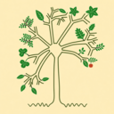
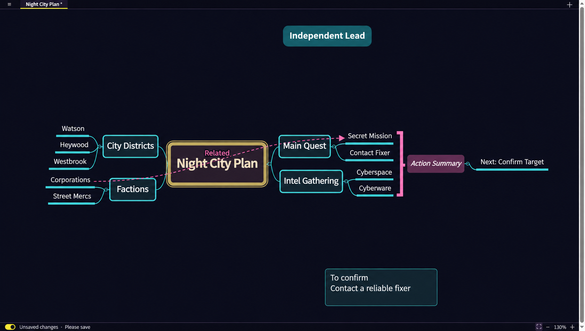

# Mini Mindmap



A simple, local-first mind map app for Linux, macOS, and Windows.

[Download](https://github.com/mbsolvr/mini-mindmap/releases) · [Report an issue](https://github.com/mbsolvr/mini-mindmap/issues)



*Illustrative preview of the Midnight theme.*

## Features

- **Local-first** — Create and edit maps without an account or internet connection.
- **Flexible maps** — Add topics, independent topics, floating notes, images, and links.
- **Multiple layouts** — Organize ideas with mind maps, logic charts, organizational charts, and fishbone diagrams.
- **Connections** — Link topics, add labels, and drag two control handles to shape each curve.
- **Summaries** — Group selected topics with a bracket and an editable summary.
- **Workspaces** — Keep several maps in tabs, each with its own canvas position and zoom.
- **Your files** — Save maps and workspaces as `.minimap` files, with auto-save and recovery for unsaved changes.
- **Export** — Share maps as Markdown, SVG, PNG, or PDF.
- **XMind exchange** — Import modern or XMind 8 workbooks into tabs and export all tabs as a modern `.xmind` workbook from the File menu. See [file formats and exchange limits](docs/file-formats.md).
- **Personalize** — Choose the Default or cyberpunk-inspired Midnight theme, adjust fonts and interface sizes, and use English, Simplified Chinese, Japanese, or Korean. The interface follows your system language unless you choose one in Settings.

## Installation

Download a package for your platform from [Releases](https://github.com/mbsolvr/mini-mindmap/releases):

- **Linux:** `.deb` or `.AppImage` for x86-64.
- **Windows:** `.exe` installer for x86-64.
- **macOS:** `.dmg` for Apple Silicon or Intel.

## Getting started

Click a topic to select it, drag it to rearrange the map, and double-click to edit. Use `Tab` to add a child topic. Press `Enter` to finish editing, then `Enter` again to add a sibling topic. Drag a topic onto empty canvas to make it independent. Right-click the canvas to add independent topics or floating notes.

To add a summary, select at least two topics with Ctrl-click (Command-click on macOS) or by dragging a selection box, then choose **Add summary** from the Edit menu or the selected topics' context menu. Summary ranges cannot overlap, and a summary or its children cannot be included in another summary. Edit the summary text directly; use its delete button to remove it, its child topics, and their connections. A summary is hidden while any of its topics is collapsed, and reappears when they are visible again. Moving a grouped topic into its own summary makes it a child and removes it from the bracket; at least one grouped topic must remain outside the summary.

Use **Save** to choose a `.minimap` file. When enabled, auto-save keeps the file up to date. Use the switch in the status bar to turn auto-save on or off. A separate recovery draft can restore unsaved work after an unexpected exit.

Choose **New workspace** in the application menu to close the current workspace and start with one blank map. Unsaved changes require confirmation. The tab bar's **＋** adds a map to the current workspace.

On Windows, double-click a `.minimap` file to open it in Mini Mindmap. If the app is already running, it opens the file in the existing window.

Maps support up to 5,000 objects and 100 levels per tab, and images up to 10 MiB each. A `.minimap` archive is limited to 256 MiB and 10,000 entries; its expanded document is limited to 268,435,456 UTF-16 code units. The same limits apply when saving and opening files.

## Keyboard shortcuts

| Shortcut | Action |
| --- | --- |
| `Tab` | Add a child topic |
| `Enter` | Finish editing, or add a sibling to the selected topic |
| `Shift+Tab` | Select and edit the parent topic |
| `Shift+Enter` | Add a line while editing |
| `Esc` | Stop editing |
| `F2` | Edit the selected topic |
| `Delete` / `Backspace` | Delete the selected topic |
| `Ctrl+Z` | Undo |
| `Ctrl+Shift+Z` / `Ctrl+Y` | Redo |
| `Ctrl+S` | Save |
| `Ctrl+Shift+S` | Save as |
| `Ctrl++` / `Ctrl+=` | Zoom in |
| `Ctrl+-` | Zoom out |
| Drag on empty canvas | Select topics |
| `Space+drag` | Pan the canvas |
| Mouse wheel / trackpad | Pan the canvas |

## Build from source

Install Node.js 22.18 or newer, npm, Rust, Cargo, and the [Tauri prerequisites](https://v2.tauri.app/start/prerequisites/) for your platform.

```sh
git clone https://github.com/mbsolvr/mini-mindmap.git
cd mini-mindmap
npm ci
npm run build
cargo run --locked --manifest-path src-tauri/Cargo.toml
```

To build a desktop executable in `build/`:

```sh
npm run build:app
```

Restart the application to use the new build. On Windows, close it before rebuilding.

To create an application package for your current platform:

```sh
npm exec tauri -- build
```

## Development

```sh
npm test                                      # Frontend tests
npm run typecheck                             # TypeScript checks
cargo test --locked --manifest-path src-tauri/Cargo.toml
npm run test:ui                               # Browser interaction tests
npm run test:stress                           # Large-map stress test
```

The browser tests require Python 3, Chromium, and a matching ChromeDriver. To run all tests in order, use `npm run test:all`; its Rust dependencies must be available in the local Cargo cache. For automated canvas measurements, see the [performance guide](docs/performance.md).

The [architecture guide](docs/architecture.md) describes state ownership and the stylesheet modules.

## Built with

[Tauri](https://tauri.app/) · [Rust](https://www.rust-lang.org/) · [React](https://react.dev/) · [TypeScript](https://www.typescriptlang.org/)

## License

[GNU Lesser General Public License v3.0 only](LICENSE) (LGPL-3.0-only).

The bundled `option-ext` component is licensed under [Apache License 2.0](src-tauri/vendor/option-ext/LICENSE).

The app icon is inspired by the cover of *Logisch-philosophische Abhandlung*.
