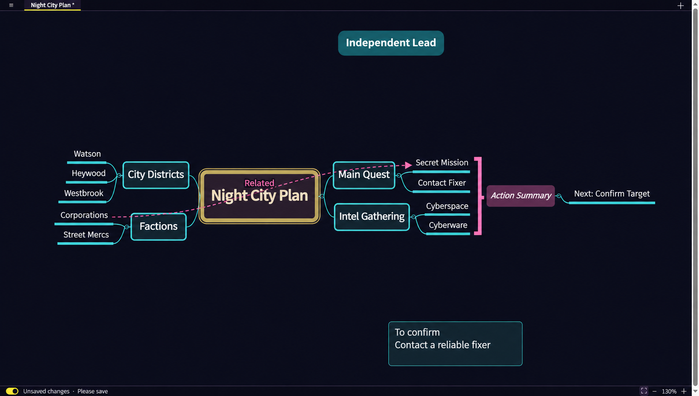

# Mini Mindmap

[English](README.md) | **简体中文**


一款简单、优先使用本地存储的思维导图应用，支持 Linux、macOS 和 Windows。

[下载](https://github.com/mbsolvr/mini-mindmap/releases) · [反馈问题](https://github.com/mbsolvr/mini-mindmap/issues)



*午夜主题示意预览。*

## 功能

- **本地优先** — 无需账号或网络连接，即可创建和编辑导图。
- **灵活的导图内容** — 支持主题、独立主题、浮动说明、图片和链接。
- **多种布局** — 支持思维导图、逻辑图、组织结构图和鱼骨图。
- **关联线** — 连接主题、添加标签，并通过拖动两个控制点调整曲线形状。
- **概要** — 用括号将多个主题归为一组，并添加可编辑的概要。
- **工作区** — 通过标签页管理多张导图，每张导图保留各自的画布位置和缩放比例。
- **文件保存** — 将导图和工作区保存为 `.minimap` 文件，支持自动保存和未保存内容恢复。
- **导出** — 将导图导出为 Markdown、SVG、PNG 或 PDF。
- **XMind 互通** — 从“文件”菜单导入现代版本或 XMind 8 工作簿，将各工作表添加为标签页；也可将全部标签页导出为现代 `.xmind` 工作簿。详见[文件格式与互通限制（英文）](docs/file-formats.md)。
- **个性化** — 提供默认主题和赛博朋克风格的午夜主题，可调整字体及界面大小，支持英语、简体中文、日语和韩语。界面默认跟随系统语言，也可在设置中手动选择。

## 安装

从[发布页面](https://github.com/mbsolvr/mini-mindmap/releases)下载适合你平台的安装包：

- **Linux：** 适用于 x86-64 的 `.deb` 或 `.AppImage`。
- **Windows：** 适用于 x86-64 的 `.exe` 安装程序。
- **macOS：** 适用于 Apple Silicon 或 Intel 的 `.dmg`。

## 快速开始

单击主题以选中，拖动以调整位置，双击以编辑。按 `Tab` 添加子主题。按 `Enter` 结束编辑，再按一次 `Enter` 为选中的主题添加同级主题。将主题拖到画布空白处，可将其变为独立主题。右键单击画布，可添加独立主题或浮动说明。

缩放按钮、键盘快捷键和 Ctrl+滚轮均以可见画布的中心为缩放中心。即使导图高于画布，该位置的内容也会保持不动。

添加概要时，按住 Ctrl 单击（macOS 上为 Command 单击）或拖动框选至少两个主题，然后从“编辑”菜单或所选主题的右键菜单中选择**添加概要**。概要范围不能重叠，概要及其子主题不能加入另一个概要。可直接编辑概要文字；使用概要的删除按钮会同时删除该概要、其子主题及相关关联线。

当部分成员主题被折叠或隐藏时，概要仍保持可见，其括号会跟随可见的成员主题卡片及其可见后代。只有当所有成员主题都被折叠或隐藏时，概要、括号及其子主题才会隐藏；任一成员展开且可见时，它们会重新显示。折叠不会删除概要数据。

将成员主题移入其所属的概要，会使其成为概要的子主题，并从括号范围中移除；概要外必须至少保留一个成员主题。

使用**保存**选择 `.minimap` 文件。启用自动保存后，文件会随修改更新。可通过状态栏开关启用或关闭自动保存。独立的恢复草稿可在应用意外退出后恢复未保存的内容。

在应用菜单中选择**新建工作区**，可关闭当前工作区并新建一张空白导图。存在未保存修改时会要求确认。标签栏上的 **＋** 用于向当前工作区添加导图。

在 Windows 上，双击 `.minimap` 文件即可用 Mini Mindmap 打开。如果应用已在运行，文件会在现有窗口中打开。

新建标签页和导入操作受每个工作区 100 个标签页的限制。已有的较大 `.minimap` 工作区仍可打开、编辑和保存（在文件容量限制内最多支持 9,999 个标签页），但标签页数量超过 100 时不能继续增加。每张导图最多支持 5,000 个对象、100 层和 5,000 条关联线，单张图片最大为 10 MiB。`.minimap` 归档最大为 256 MiB，最多包含 10,000 个条目；展开后的文档最多包含 268,435,456 个 UTF-16 代码单元。JSON 解析最多允许 100,000 个对象或数组，容器嵌套最多为 512 层；XMind XML 与其样式共用 100,000 个标记分隔符的解析预算。超限文件会被拒绝，不会截断数据。编辑器和导入操作在提交修改前使用相同的整工作区结构预算进行检查；超限操作不会改变当前工作区和历史记录。恢复草稿使用相同的文档限制。

## 键盘快捷键

| 快捷键 | 操作 |
| --- | --- |
| `Tab` | 添加子主题 |
| `Enter` | 结束编辑，或为选中的主题添加同级主题 |
| `Shift+Tab` | 选中并编辑父主题 |
| `Shift+Enter` | 编辑时换行 |
| `Esc` | 停止编辑 |
| `F2` | 编辑选中的主题 |
| `Delete` / `Backspace` | 删除选中的主题 |
| `Ctrl+Z` | 撤销 |
| `Ctrl+Shift+Z` / `Ctrl+Y` | 重做 |
| `Ctrl+S` | 保存 |
| `Ctrl+Shift+S` | 另存为 |
| `Ctrl++` / `Ctrl+=` | 放大 |
| `Ctrl+-` | 缩小 |
| 在画布空白处拖动 | 框选主题 |
| `Space`+拖动 | 平移画布 |
| 鼠标滚轮 / 触控板 | 平移画布 |

## 从源码构建

安装 Node.js 22.18 或更新版本、npm、Rust、Cargo，以及对应平台的 [Tauri 前置依赖](https://v2.tauri.app/start/prerequisites/)。

```sh
git clone https://github.com/mbsolvr/mini-mindmap.git
cd mini-mindmap
npm ci
npm run build
cargo run --locked --manifest-path src-tauri/Cargo.toml
```

构建桌面可执行文件并输出到 `build/`：

```sh
npm run build:app
```

重启应用以使用新构建的版本。在 Windows 上，请先关闭应用再重新构建。

为当前平台创建安装包：

```sh
npm exec tauri -- build
```

## 开发

```sh
npm test                                      # 前端测试
npm run typecheck                             # TypeScript 检查
cargo test --locked --manifest-path src-tauri/Cargo.toml
npm run test:ui                               # 浏览器交互测试
npm run test:stress                           # 大型导图压力测试
```

浏览器测试需要 Python 3、Chromium 和版本匹配的 ChromeDriver。运行 `npm run test:all` 可依次执行全部测试；所需的 Rust 依赖必须已存在于本地 Cargo 缓存中。自动化画布测量方法见[性能指南（英文）](docs/performance.md)。

[架构指南（英文）](docs/architecture.md)说明了状态管理职责及样式表模块的划分。

## 技术栈

[Tauri](https://tauri.app/) · [Rust](https://www.rust-lang.org/) · [React](https://react.dev/) · [TypeScript](https://www.typescriptlang.org/)

## 许可证

[GNU 宽通用公共许可证第 3 版（仅限此版本）](LICENSE)（LGPL-3.0-only）。

随附的 `option-ext` 组件使用 [Apache License 2.0](src-tauri/vendor/option-ext/LICENSE)。

应用图标的灵感来自 *Logisch-philosophische Abhandlung* 的封面。
